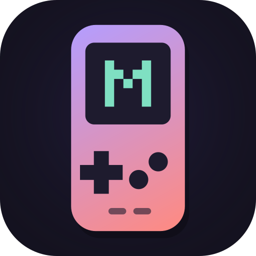

<p align="center"></p>

# MicroBoy

A native Android Game Boy Advance emulator built with Kotlin and Jetpack Compose,
running the [mGBA](https://mgba.io) emulation core.

- Accurate emulation from mGBA: ARM7TDMI CPU, PPU, APU, DMA, timers, and SRAM/Flash/EEPROM saves.
- **Real fast-forward.** Frames really run 2×, 3×, 4× or 8× faster, or as fast as the device allows. You can hold to fast-forward or tap to toggle it. Audio is muted while fast-forwarding.
- Cartridge saves are separate from save states. You get 9 manual slots plus an Auto slot, quick save/load, thumbnails, export/import, and a confirmation before anything is overwritten.
- Your library keeps ROMs where they are on your device (Storage Access Framework), and tracks recently played games, playtime, and box art.
- Touch controls are multi-touch and themed, with editable layouts for portrait and landscape and haptic feedback. Bluetooth and USB controllers work too, with remappable buttons.
- Display options: fit, integer, or stretch scaling, smoothing, scanline, LCD-grid and CRT filters, brightness, saturation, and GBA color correction.
- 11 color themes, plus a fully custom theme (HSV picker) and wallpaper colors on Android 12+.
- Low-latency AAudio output with dynamic rate control, audio-focus handling, and auto-pause when headphones are unplugged.

Website: **https://m4s4t0-v01d.github.io/GBA-Emulator/** (source in [docs/](docs/), served by GitHub Pages).

See [PLAN.md](PLAN.md) for the design rationale.

## Building

Requirements: JDK 17, Android SDK (platform 36), NDK 27.2.12479018, CMake 3.22.1. Gradle downloads missing SDK parts on the first build once the SDK licenses are accepted (`sdkmanager --licenses`).

```sh
git clone --recursive https://github.com/M4S4T0-V01D/GBA-Emulator.git
cd GBA-Emulator
echo "sdk.dir=$HOME/Android/Sdk" > local.properties
./gradlew assembleDebug        # app/build/outputs/apk/debug/app-debug.apk
./gradlew assembleRelease      # app/build/outputs/apk/release/app-release.apk
```

If you forgot `--recursive`, run `git submodule update --init`.

### Release signing

Create `keystore.properties` in the repo root (it is git-ignored):

```properties
storeFile=microboy-release.jks
storePassword=…
keyAlias=microboy
keyPassword=…
```

Without it, `assembleRelease` signs with the debug key, which is fine for sideloading.

## Installing on a phone

1. Copy the APK to the phone, or connect it with USB debugging enabled.
2. With a cable: `adb install -r app/build/outputs/apk/release/app-release.apk`
3. Without a cable: open the APK in a file manager and allow "Install unknown apps" for that file manager when asked.

You need Android 8.0 (API 26) or newer. The APK includes arm64-v8a, armeabi-v7a and x86_64 builds.

## Architecture

```
app/src/main/
├── cpp/                       native layer (C)
│   ├── jni_bridge.c           mGBA mCore lifecycle, frames, keys, save states, save flush
│   ├── audio.c                AAudio stream + lock-free SPSC ring buffer
│   └── CMakeLists.txt         builds mGBA (GBA core only) as a static lib
└── java/dev/m4s4t0/microboy/
    ├── emulation/             EmulatorSession (emu thread, pacing, fast-forward), NativeCore (JNI)
    ├── render/                GameRenderer: GLES2 quad, scaling, filter shader
    ├── input/                 TouchControllerView, GamepadInput, layouts + mappings
    ├── data/                  Library (JSON), Settings (DataStore), Storage, ROM/save I/O, box art
    └── ui/                    Compose screens: library, game, save manager, settings, themes
```

**Threads**

| Thread | Job |
|---|---|
| UI | Compose only. It never waits on emulation. |
| Emulation | Runs `runFrame()` and paces itself to 59.7275 Hz with a monotonic clock. Commands (save state, reset, …) run between frames. When paused, the thread sleeps on a lock and uses no CPU. |
| GL | Copies the newest frame into one preallocated buffer and draws it. The steady state allocates nothing. |
| AAudio callback | Reads from the ring buffer. The emulation thread adjusts the resampling ratio by up to ±0.5% based on how full the buffer is (dynamic rate control), which prevents drift, pops and underruns. |

**Fast-forward**

Each display period, the emulation thread runs N real frames, or keeps running frames until the period is used up at "Max". Only the last frame is displayed. Audio produced during fast-forward is thrown away, and the queue is flushed when fast-forward starts and stops, so there is no distortion.

**Saves**

- **Cartridge saves:** `files/saves/<sha1>.sav`. mGBA memory-maps this file (`MAP_SHARED`), so the game's writes land in the file directly. The file is also flushed on pause, background and exit.
- **Save states:** `files/states/<sha1>/slotN.state` plus a `.png` thumbnail. Writes are atomic (temp file + fsync + rename). Loading a state never touches the cartridge save. If a state fails to load, the previous emulator state is restored.
- Games are identified by the SHA-1 of the ROM, so saves still match after a ROM file is moved or renamed.

**BIOS**

MicroBoy ships no BIOS. mGBA's built-in open-source BIOS replacement is used unless you choose a 16 KB `gba_bios.bin` from your own console in Settings.

## Test ROMs

| ROM | Source | License | Purpose |
|---|---|---|---|
| `testroms/microboy-test/microboy-test.gba` | written for this project (`build.sh`, clang + lld) | public domain | input, audio, frame counter (speed), SRAM persistence |
| `testroms/microboy-demo/microboy-demo.gba` | written for this project (`build.sh`: `gen.py` + clang + lld) | CC0 | the website's endless pixel scene: tiled-background parallax, sprites, palette themes, PSG music. Downloadable from the website |

`tools/romshot.sh BUILD_DIR` builds `romshot`, which runs a ROM headless on the mGBA submodule and writes PPM screenshots plus the audio level. That lets you check homebrew ROMs without a device: `romshot ROM OUTDIR 60 600 700:a 760` saves frames 60, 600 and 760, and presses A at frame 700.
| `testroms/jsmolka/*.gba` | [jsmolka/gba-tests](https://github.com/jsmolka/gba-tests) | MIT | CPU (ARM/Thumb), memory, PPU, SRAM/Flash saves |

The project includes no commercial ROMs or BIOS files.

## Dependencies and licenses

| Component | License |
|---|---|
| mGBA 0.10.5 (git submodule, unmodified) | MPL-2.0 |
| AndroidX / Jetpack Compose / Material 3 | Apache-2.0 |
| kotlinx.coroutines / kotlinx.serialization | Apache-2.0 |
| jsmolka gba-tests (test ROMs only, not shipped in the APK) | MIT |

MPL-2.0 is file-level copyleft: mGBA's source files must stay available under MPL-2.0. That is satisfied by the submodule and the attribution in Settings → About.

## Known limitations

See the testing section below for what has been verified.

- Tested on one physical phone so far (2026-10-15): video, input and cartridge saves work. Audio was silent before commit f516356, which fixed it.
- Solar-sensor, tilt, rumble and link-cable peripherals are not emulated in the frontend.
- Box-art download only works when the ROM's file name matches No-Intro naming.
- Game Boy / Game Boy Color games are not supported. mGBA's GB core is disabled to keep the app focused.

## Status / next steps

Done and building: native mGBA bridge, AAudio, GL renderer, touch and controller input, library, save states, settings, themes, logo.

**First device test passed** (2026-10-15, Pokémon Emerald): video, input and cartridge saves work. The silent-audio bug found there is fixed. The app targets API 36, as Google Play requires.

Requested next, not started: rewind, slow motion, gyro/tilt/solar sensors, link cable / multiplayer, and cloud save sync.

Planned visual-engine work, requested and not started:

- JSON shell-theme profiles with hex colors (Atomic Purple, Glacier Blue, Spice Orange, …), import/export, and an HSV wheel + RGB picker.
- Ambient lighting: average the frame's edge pixels and project a glow around the viewport, plus a tinted bezel.
- Shader controls for contrast and gamma, plus an RGB-subpixel "matrix LCD" mode.
- Skins: an image plus JSON with normalized screen/button coordinates, palette extraction, and auto-detection of the screen area.
